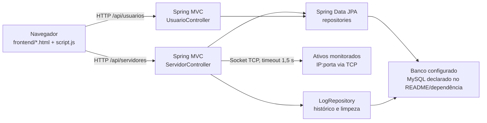

# Visão geral da arquitetura

## Componentes confirmados

O repositório contém uma aplicação Java/Spring Boot e um frontend estático separado. O Java inicia em `MonitorApplication.main` e habilita tarefas agendadas. Os controladores REST acessam repositórios Spring Data JPA; o frontend usa `fetch` diretamente contra uma URL de API codificada no JavaScript.

O driver MySQL está no `pom.xml` e há configurações ativas de datasource/JPA em [`application.properties`](../../../src/main/resources/application.properties). Os valores não são transcritos aqui. O README também cita MySQL; não foi possível confirmar em execução qual banco está disponível.

## Tecnologias e responsabilidades

| Parte | Responsabilidade | Evidência |
|---|---|---|
| Inicialização | Configuração Spring Boot e habilitação de scheduling | [`MonitorApplication.java`](../../../src/main/java/com/systemup/monitor/MonitorApplication.java), `MonitorApplication`, `@EnableScheduling` |
| API de ativos | CRUD, teste TCP sob demanda e consulta/limpeza de logs | [`ServidorController.java`](../../../src/main/java/com/systemup/monitor/ServidorController.java), `ServidorController` |
| API de usuários | Cadastro e comparação de senha | [`UsuarioController.java`](../../../src/main/java/com/systemup/monitor/UsuarioController.java), `UsuarioController` |
| Modelo/persistência | Entidades JPA e interfaces `JpaRepository` | [`Servidor.java`](../../../src/main/java/com/systemup/monitor/Servidor.java), [`Usuario.java`](../../../src/main/java/com/systemup/monitor/Usuario.java), [`Log.java`](../../../src/main/java/com/systemup/monitor/Log.java) |
| Interface | Dashboard, cadastro de ativos, cadastro/login e estilos | [`frontend/`](../../../frontend), [`script.js`](../../../frontend/script.js), [`style.css`](../../../frontend/style.css) |

O manifesto declara Java 25, Spring Boot 4.0.3, Spring MVC, Spring Data JPA, MySQL Connector/J, Lombok e Spring Security; os starters de teste estão no escopo de teste. Consulte [`pom.xml`](../../../pom.xml).

## Limites da arquitetura observada

- A verificação de disponibilidade é disparada pelo `GET /api/servidores`, chamado pelo dashboard; `@Scheduled` é usado para apagar logs antigos, não para fazer sondagens periódicas independentes.
- O frontend atual aponta para `localhost:8080`. Não há configuração de implantação ou de URL externa identificada no código examinado.
- Não há serviços de domínio separados: a lógica observada está principalmente nos controladores.
- Não foram encontrados documentos de decisões arquiteturais (ADR); portanto, as escolhas descritas aqui são fatos do código, não decisões formalmente justificadas.

Relacionados: [[02 - Modulos/Backend API|backend]], [[02 - Modulos/Frontend|frontend]], [[04 - Dados/Modelo de dados|dados]] e [[05 - Interfaces e Integracoes/API REST|API]].

Voltar para [[01 - Arquitetura/Indice|índice de arquitetura]].
