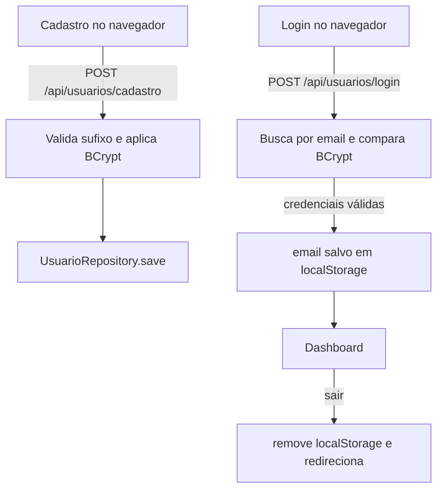

# Cadastro, login e saída

## Cadastro

O formulário em [`frontend/cadastro.html`](../../../frontend/cadastro.html) coleta nome, email e senha e chama `POST /api/usuarios/cadastro`. O backend aceita emails terminados em `@systemup.inf.br`, aplica BCrypt na senha e persiste o usuário. Sucesso resulta em navegação para `login.html`.

## Login e saída

O formulário de [`frontend/login.html`](../../../frontend/login.html) envia email e senha a `POST /api/usuarios/login`. Se as credenciais forem válidas, o frontend grava o email em `localStorage` com a chave `usuarioLogado` e navega para o dashboard; caso contrário, mostra uma mensagem de erro. `sair()` remove essa chave e redireciona ao login.

O dashboard verifica a chave local para o redirecionamento de interface, mas o servidor não recebe um token/sessão para autorizar as chamadas de ativos. Veja [[02 - Modulos/Seguranca|segurança e autenticação]].

## Diagrama resumido

Voltar para [[03 - Fluxos/Indice|índice de fluxos]].
