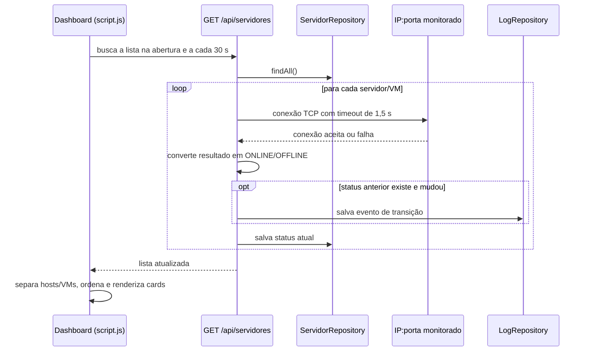

# Fluxo de monitoramento

## Caminho da consulta

O método `renderizar()` de [`frontend/script.js`](../../../frontend/script.js) faz a chamada inicial quando o DOM está pronto e configura `setInterval(renderizar, 30000)`. A consulta GET não é somente leitura: no backend ela testa cada conexão e persiste os status.

## Status e eventos

`ServidorController.testarConexao()` tenta abrir um socket TCP no IP e porta registrados. Uma conexão concluída indica `ONLINE`; exceção indica `OFFLINE`. Apenas quando o status anterior não é nulo e difere do novo valor é criado log de mudança. A primeira verificação de um ativo ainda sem status, portanto, não gera evento de transição.

Os registros identificam o ativo pelo nome (`servidorNome`), sem chave estrangeira para `Servidor`. A interface permite consultar o histórico individual e a API também expõe os dez logs globais mais recentes. A limpeza agendada remove registros com mais de 24 horas.

## Apresentação

O frontend apresenta hosts como cards e agrupa VMs pelo `paiId` para abrir detalhes. Uma VM offline gera indicação visual de alerta no host; a notificação nativa do navegador é disparada somente para host offline. Os ativos offline são priorizados na lista.

Ver [[04 - Dados/Modelo de dados|modelo de dados]], [[02 - Modulos/Backend API|implementação do backend]] e [[05 - Interfaces e Integracoes/API REST|endpoints]].

Voltar para [[03 - Fluxos/Indice|índice de fluxos]].
